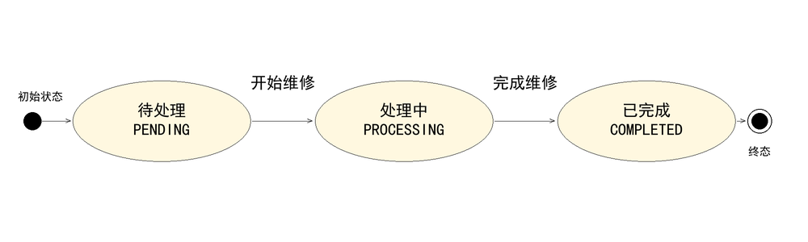
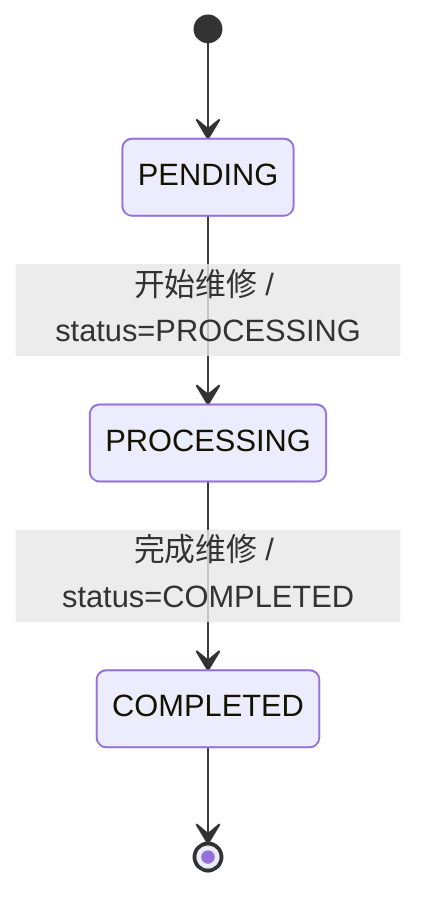
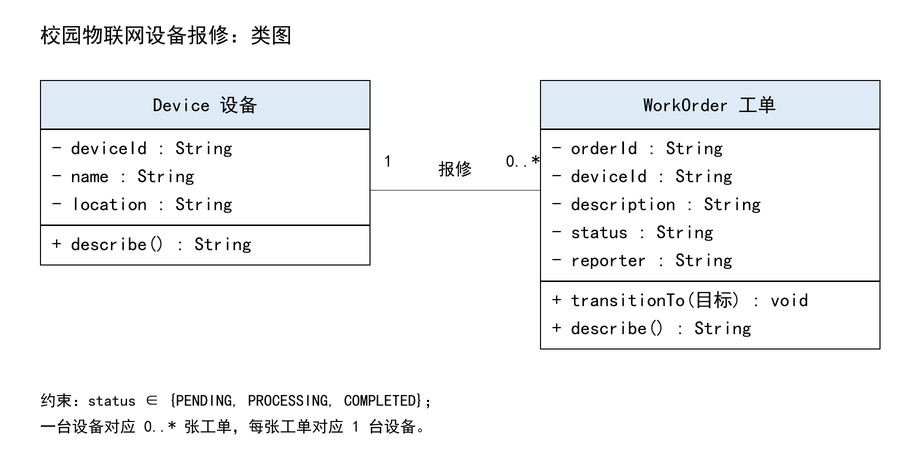
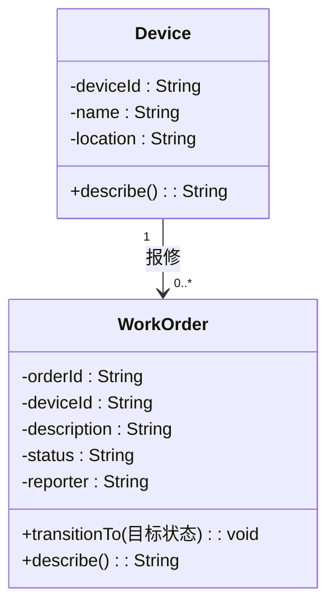

# 状态图与简单类图

## 状态图

状态图源材料（Mermaid 代码块，GitHub 可直接渲染）：

同时提供可编辑矢量源文件 [`assets/state.svg`](assets/state.svg)。

状态说明：

| 中文状态 | 程序取值 | 含义 | 是否终态 |
| --- | --- | --- | --- |
| 待处理 | `PENDING` | 工单已创建，等待维修人员受理 | 否 |
| 处理中 | `PROCESSING` | 维修人员已开始维修 | 否 |
| 已完成 | `COMPLETED` | 维修结束，工单关闭 | 是 |

图中只有两条出边：`PENDING → PROCESSING`（开始维修）、`PROCESSING → COMPLETED`（完成维修）。
跳级（`PENDING → COMPLETED`）、回退（`COMPLETED → PROCESSING`）、状态不变以及未知状态值
在图中没有对应边，即被拒绝。

## 简单类图

类图源材料（Mermaid 代码块）：

同时提供可编辑矢量源文件 [`assets/class.svg`](assets/class.svg)。

- `Device` 至少包含 `deviceId`、`name`、`location` 三个属性；
- `WorkOrder` 至少包含 `orderId`、`deviceId`、`description`、`status` 四个属性，
  另记录 `reporter` 等追踪信息；
- 一台设备对应 **0..\* 张**工单（设备可以从未报修过），每张工单对应 **1 台**设备，
  多重性标注在关联两端；
- 工单只通过 `transitionTo()` 修改状态，是否允许由 `status_rule.can_transition()` 统一判断。

## 与需求的一致性检查

- [x] 中文状态与程序英文值一一对应：待处理-PENDING、处理中-PROCESSING、已完成-COMPLETED
- [x] 只允许两条转换，与 FR-03 的“其余转换一律拒绝”一致
- [x] 初始状态为 PENDING，与 FR-02“新工单初始为待处理”一致
- [x] 一台设备与多张工单的关系及多重性（1 对 0..*）清楚
- [x] 图与代码一致：`src/python/status_rule.py` 的允许集合只有两条，其余返回 False
