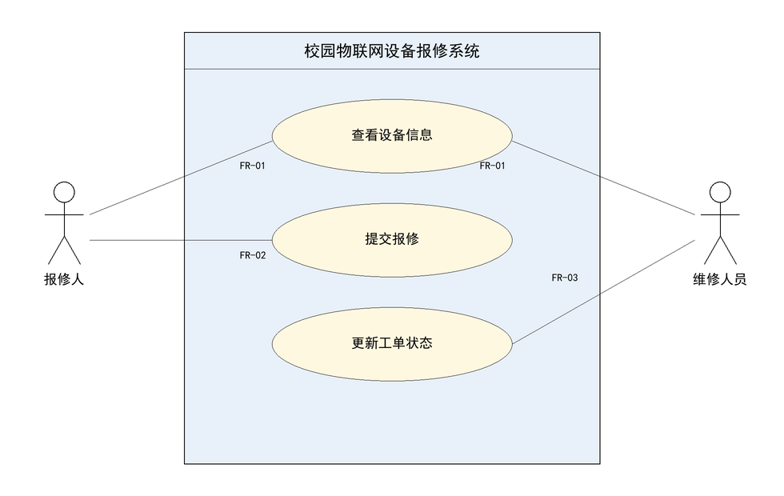

# 用例图与角色说明

## 用例图

可编辑源文件：[`assets/usecase.svg`](assets/usecase.svg)（矢量源，可用浏览器、Inkscape 或
draw.io 打开后修改）。图片引用使用仓库相对路径，不使用本机磁盘路径。

## 角色说明

| 参与者 | 可执行的用例 | 说明 |
| --- | --- | --- |
| 报修人 | 查看设备信息、提交报修 | 只能查看清单内设备并提交报修，不能改变工单状态 |
| 维修人员 | 查看设备信息、更新工单状态 | 可受理待处理工单并完成维修，不代替报修人填写故障描述 |

| 用例 | 关联需求 | 前置条件 | 结果 |
| --- | --- | --- | --- |
| 查看设备信息 | FR-01 | 清单已加载 | 显示编号、名称、位置；编号不存在时提示 |
| 提交报修 | FR-02 | 设备在清单内、描述非空 | 生成状态为 `PENDING` 的工单 |
| 更新工单状态 | FR-03 | 工单存在 | `PENDING→PROCESSING→COMPLETED`，其余转换拒绝 |

系统边界内只有上述三个用例。数据库、温湿度传感器、网关等是系统外部或内部的技术构件，
**不作为操作者**出现在图中。

## 图的自查

- [x] 两个参与者：报修人、维修人员
- [x] 三个主要用例：查看设备信息、提交报修、更新工单状态
- [x] 系统边界清楚，边界外只有两个参与者
- [x] 参与者与用例连接正确：报修人连“查看设备信息”“提交报修”，维修人员连
      “查看设备信息”“更新工单状态”
- [x] 源文件（`usecase.svg`）与导出图（`usecase.png`）内容一致，由同一份坐标数据导出
- [x] 未把数据库、设备本身画成操作者
